# TLoZ:TWW HD Recompiled — Android

An Android port of the [ZeldaWWHDRecomp](https://github.com/ZeldaWWHDRecomp/ZeldaWWHDRecomp) project:
The Legend of Zelda: The Wind Waker HD (Wii U, USA, European and Japanese versions) as a native app for 64-bit ARM Android
devices. The game's PowerPC code is recompiled to native ARM code, the Wii U system libraries the
game uses are reimplemented, and its graphics run directly on Vulkan. There is no emulator in
between.

**The app contains no game files.** You bring your own copy of the game: a disc image (`.wud` or
`.wux`) dumped from your own Wii U disc, with its keys, or a Cemu archive (`.wua`) made from it. On the first start the app extracts the game
from it and builds the game code on your device.

The original project (macOS, the 60 fps modes, decompilation tools) is described in
[docs/original-readme.md](docs/original-readme.md); how the recompilation works in
[docs/how-it-works.md](docs/how-it-works.md).

## What this fork adds

| | |
|---|---|
| 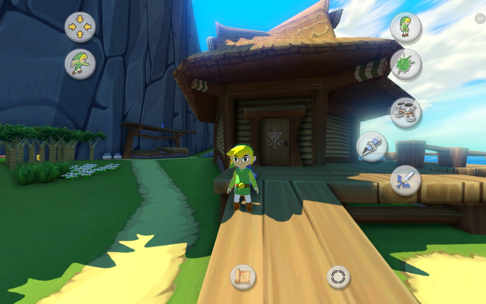 | 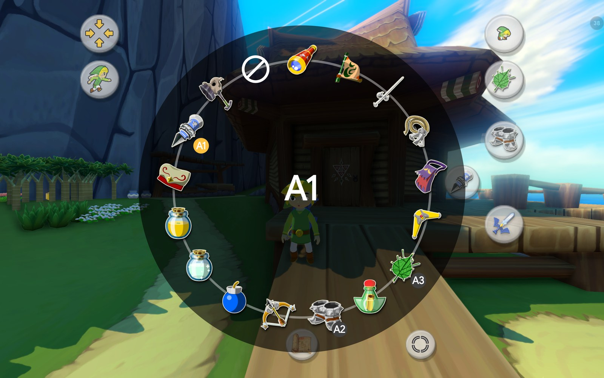 |
| *Flexible touch controls with context buttons and Link in the button icons, on Outset Island* | *Hold an item button: the item ring* |
| 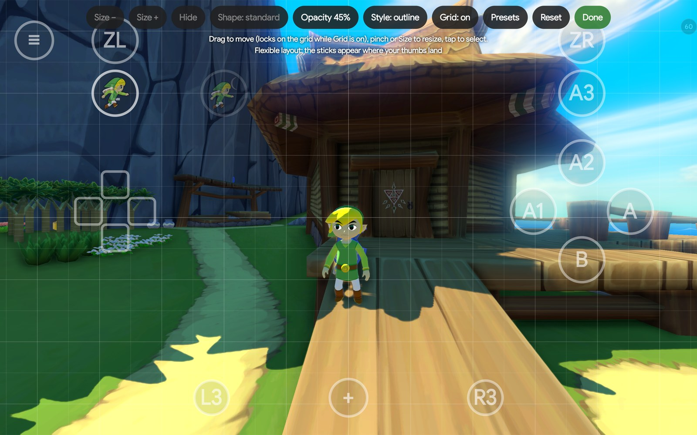 | 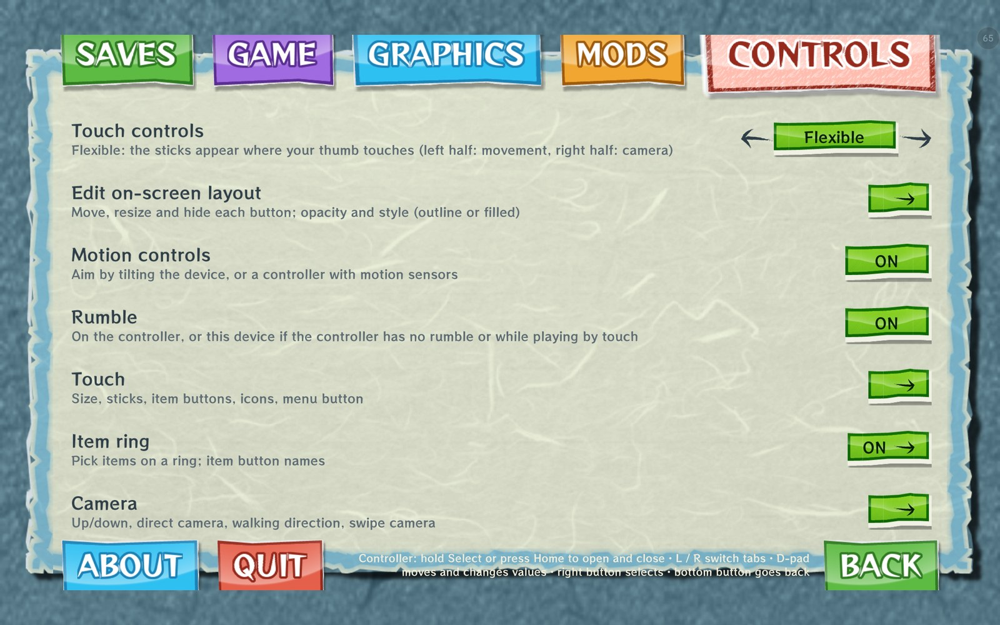 |
| *The layout editor with its grid* | *The options as a page of the + menu, in the game's style* |
| 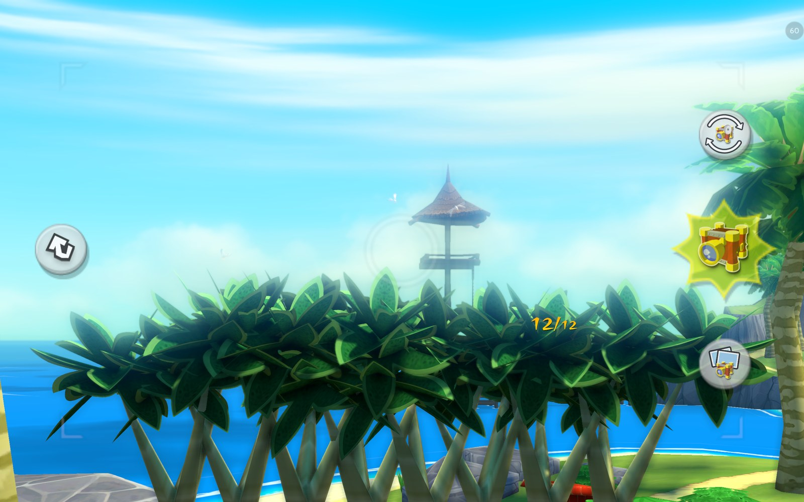 | 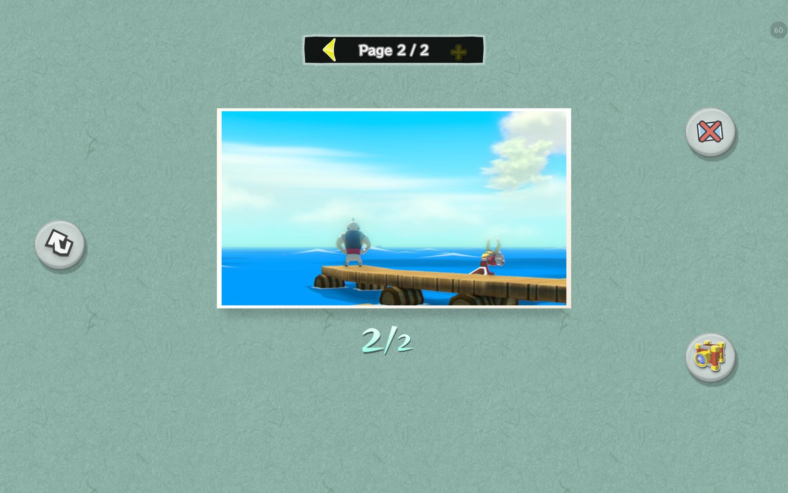 |
| *The large Picto Box view* | *Album pages: a full album goes on to page 2* |
| 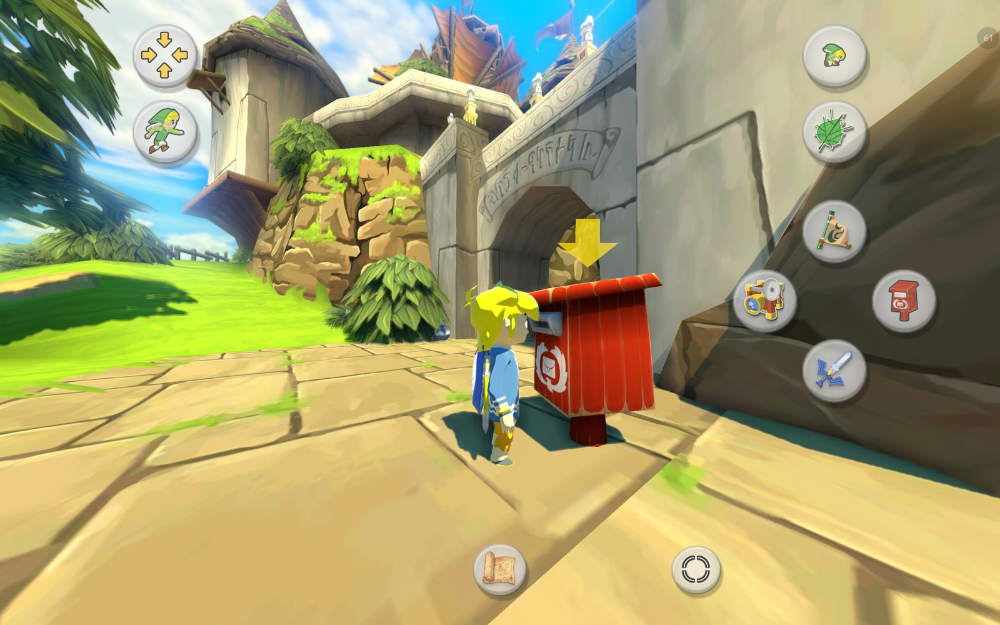 | 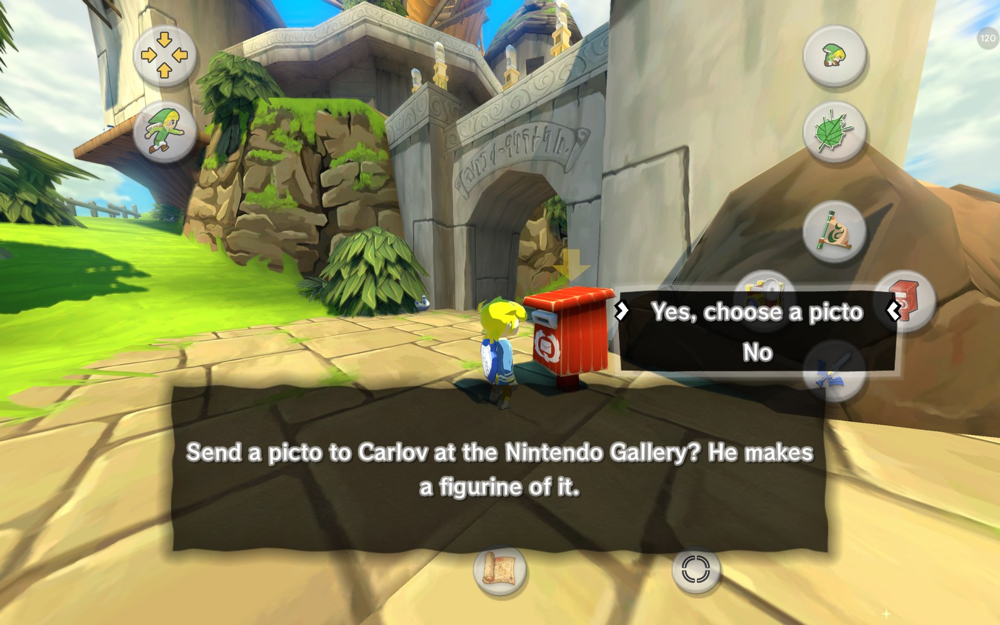 |
| *At a postbox, A shows the postbox itself* | *The postbox offers to send a picto to Carlov* |
| 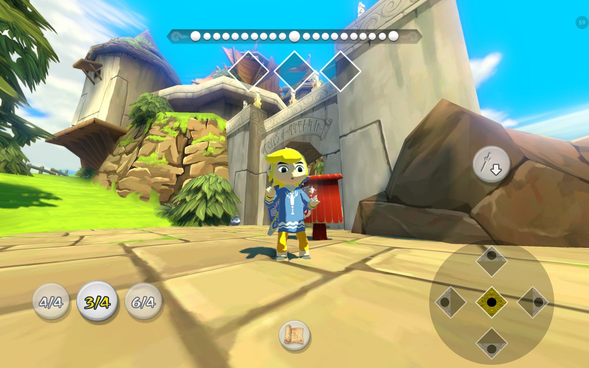 | 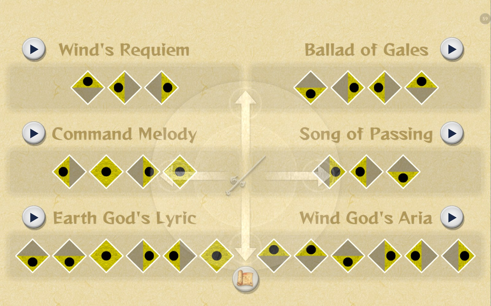 |
| *Note pads for conducting* | *Play buttons in the + song list* |
| 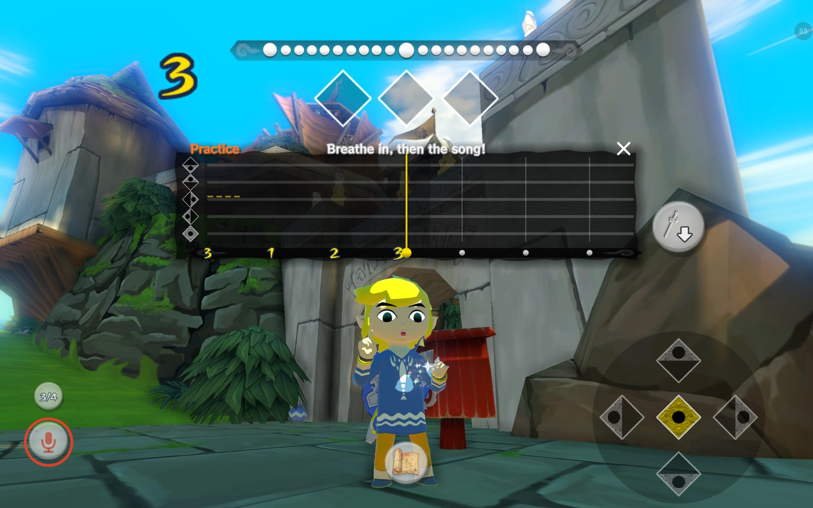 | 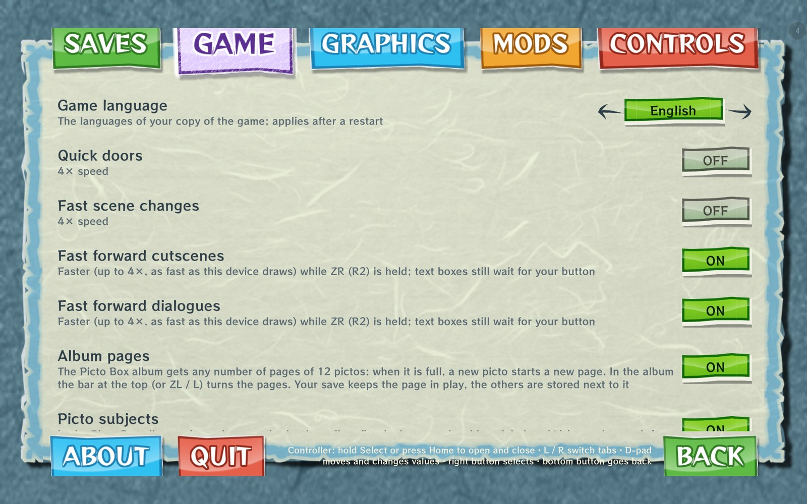 |
| *Singing a song: the practice timeline* | *The Game tab with the new options* |


- **Android port**: Vulkan renderer, AAudio sound, touch screen, game controllers and hardware
  keyboards.
- **An APK without game code**: on the first start the app extracts the game from your disc image or `.wua` archive
  and recompiles its code on the device with LLVM (once; a few minutes on a fast phone, longer on
  slower ones). Later starts load the
  compiled code in about half a second. The work continues in the background with a progress
  notification, and resumes where it stopped if the app is closed.
- **Frame generation** with Lossless Scaling's LSFG 3 (see below): 60, 90 or 120 fps.
- **60 fps by frame interpolation** (the original project's, Graphics › Frame rate): the game draws
  an extra frame between its 30 steps a second, without the Lossless.dll; 120 fps on screens with
  120 Hz or more. It needs a fast phone (60 fps on a Snapdragon 7+ Gen 3); where a frame doesn't
  fit in time it is left out, so the game always keeps its speed. Works together with frame
  generation ×2.
- **An in-game options menu** that looks like the game's own GamePad menus (its paper, tabs, buttons
  and fonts, taken from your game files), as a page of the game's + menu, with tabs for saves, the
  game, graphics, mods and controls, usable by touch and with a controller (see below); it fits phone
  screens too.
- **Six languages**: the app's texts in English, German, French, Italian, Spanish and Japanese,
  following the game's language.
- **Save states**: five slots with a picture, time and place of each state. Saving stops the game
  for only a few hundredths of a second (the memory is copied in the background), and a state loads
  anywhere: in the game, at the title screen or the file select. An auto save every 2, 5 or 10 minutes
  into two slots of its own, a "Last session" state when you leave the app or quit, and at start the
  choice of the intro, the save states, or straight back into the last session.
- **Import and export** of the game save and the save states as one backup file, and **GameCube
  saves** (`.gci`, USA, Europe and Japan) imported as the HD game save (after the original project's
  converter).
- **Mod packs**: Cemu graphic packs (for example from GameBanana or GitHub) and plain game file mods,
  imported from `.zip` and `.rar` files: code patches (`patch_*.asm`, Cemuhook `patches.txt`), game
  file replacements, shader replacements and texture filtering rules. A code patch only applies to
  the game version it was made for; turning packs on or off recompiles the changed code once.
- **Performance overlay**: frame rate with its average, frame time, CPU and GPU load, CPU, GPU and
  battery temperatures, the graphics settings in use, the SoC, GPU and GPU driver; you choose the
  values and drag it where you want it.
- **The European and Japanese versions** as well as the USA one, with all features: the game code
  of all three is the same program at shifted addresses, and the app's hooks and mods find their
  places in each (`tools/recomp/port_addresses.py` matches the executables; the address maps it
  writes are in `tools/recomp/release_eur.txt` and `release_jpn.txt`).
- **Game language**: the languages of your copy (USA: English, French, Spanish; Europe: also German
  and Italian; Japan: Japanese), by default the device's language setting is used.
- **Custom GPU drivers** on Adreno GPUs (see below): Mesa Turnip or newer Qualcomm drivers.
- **Widescreen**: the game renders at the screen's shape and shows more to the sides; the HUD keeps
  its proportions at the screen edges.
- **The Wii U's sun and haze**: the sun's corona and lens flare (hidden behind walls and hills as on
  the console), the haze in the distance and the bloom around bright light.
- **Display options**: rendering resolution from 0.5× to 3×, dynamic resolution (lowered by itself
  while the GPU can't keep up, down to a limit you choose), sharp or bilinear upscaling, a display
  resolution that draws the picture only as large as it needs to be on high-resolution screens,
  aspect ratio (bars, stretched, or filling the screen), screen layouts for the TV and GamePad
  pictures (GamePad inset, side by side, TV with the GamePad on +, GamePad with TV inset). All of
  them apply immediately, without a restart.
- **One controller, the GamePad**: every controller and the on-screen controls act as the Wii U
  GamePad, with its gyro aiming and rumble. On a single screen, + shows the touchable GamePad
  screen (items, map, bottles) in place of the TV picture and pauses the game, and + again goes
  back. With a controller, a highlight in the game's own cursor style moves over the GamePad
  screen: A taps, Y / X / R put the highlighted item on that button, B goes back. The title
  screen's controller question is answered by itself (from the original project).
- **Dual-screen devices** (AYN Thor and the like): the GamePad picture goes to the second screen by
  itself, with touch, and the main screen shows the TV picture; Graphics › GamePad screen switches
  back to the screen layouts. The GamePad screens (items, map, bottles) fill a second screen of
  another shape, such as the Thor's lower screen; Graphics › GamePad picture keeps the original 16:9.
- **New touch controls** (see the [controls guide](docs/new-controls.md)): a Classic fixed GamePad or
  Flexible sticks where the thumbs land; context buttons that appear when they do something and show
  what with the game's own icons; items aimed and shot by tapping; an item ring (hold X, Y or R);
  a layout editor with a grid, button shapes, opacity and saved layouts; Link drawn in the button
  icons; a large Picto Box view. They hide while a controller is in use.
- **Minigames and menus by touch**: Sploosh Kaboom, the picture puzzles, mail sorting, the cannon,
  the auction, shops, the gallery's figures, the wind compass, answers and number entry, with a first
  time hint in the game's message style.
- **The songs**: conducting by note pads, play buttons in the song list and in the story scenes that
  wait for a song, and (experimental) singing, humming or whistling a song into the microphone.
- **Controller setup**: face buttons by position or by letters, ready-made layouts for Jump anywhere,
  L1 and d-pad down as item buttons, controller details.
- **Graphics presets** and a 2-minute test that finds the best settings for the device.
- **Picto Box album and postboxes**: an album with any number of pages of 12 pictos, the subject of
  each picto named (with the game's gold medal when it is good enough for a figurine), and pictos
  mailed to Carlov from any postbox, so his figurines arrive in the Nintendo Gallery without a trip
  there. **Link's clothes**: the hero's or the casual ones at any time.
- **Gyro aiming** with the device's motion sensors or a controller's (DualSense, DualShock 4, Switch
  Pro and others that Android reports with sensors).
- **Rumble** on the controller in use, or on the device while playing by touch.
- **The original project's gameplay mods** on Android: climb any wall, direct right-stick camera,
  first person on the mouse wheel, quick doors, fast scene changes.
- **Walking direction**: Link keeps walking his way while the camera turns, optionally with the camera
  swinging back behind him; a zoomed-out field of view.
- **Faster running, swimming, climbing and sidling** (new mods): 1.25 up to 4 times as fast;
  everything else keeps its speed.
- **Jump anywhere** (a new mod): its button jumps from standing or running, as off a ledge, with an
  optional double jump and without the automatic ledge jumps. **Moon jump**: hold its button to rise
  and fly. Both have their own touch buttons and any controller button you choose.
- **Inverted camera up/down** for first person and aiming, or always (contributed by Abssenta).
- **Fast forward** (a new mod): hold ZR (R2) to run cutscenes and dialogues faster, switched
  separately. The game plays its normal frames, only more of them per second (up to 4×, as fast as
  the device can draw them: about 2× on a Snapdragon 7+ Gen 3), so nothing is skipped; text boxes
  still wait for your button.
- **Performance work for weaker devices**, above all Mali GPUs: textures wait only for the shader
  stage that reads them (on a Helio G85 / Mali-G52 MC2 at 0.5×: 19.7 → 28.5 fps), clears done as
  part of the next render pass, mipmap chains built in place and only as far as they are read,
  exact float multiplies only where a value can be infinite (Mali-G52 at 1×: GPU time 47 → 40 ms),
  shadows with emulated depth clamping where the GPU has none, BC textures unpacked on the GPU where
  it can't sample them (most Mali and PowerVR GPUs), vertex byte swaps PowerVR drivers decode
  correctly. On the CPU side: faster recompiled game code
  (guest registers in the CPU's own registers, cheaper function entries and memory accesses, hot
  functions grouped together), a render thread with a third less work, unchanged vertex and index
  data kept across frames, a second thread for the Vulkan commands, the game and render threads on
  the fast cores, Android performance hints and game modes. On a Helio G85 / Mali-G52 MC2, 0.75×
  rendering resolution is now playable at close to 30 fps.
- **Crash logs**: if the game crashes, the next start offers its log in Android's share menu, for a
  bug report. It shows where the game crashed and with which app and game version, device and
  settings; it contains no personal data. About › Share crash logs shares the logs kept; a shared
  log is deleted at the next start.
- **Fixes**: correct lighting on the first visit to a scene with an empty shader cache; game files
  found on devices whose storage tells upper and lower case apart; Picto Box pictures in colour
  (the game reads them back from the GPU to save them).
- **No internet access**: the app doesn't request it, and its manifest explicitly excludes it.

## Version history

**0.9.6**

- New touch controls: Classic or Flexible (sticks where the thumbs land, camera by stick or swipe),
  context buttons with the game's icons and words, items by tap (aim once, tap Shoot, B puts away),
  the item ring (hold X, Y or R), item button names (A1–A3, the controller's, or X / Y / R) and
  emptying, a layout editor with a grid, shapes, opacity and saved layouts, Link in the button icons,
  left stick following the thumb, ZL after a defeated target, the large Picto Box view, hearts only in
  combat and rupees only when they change. Explained in the [controls guide](docs/new-controls.md).
- Link in the button icons, animated: jumping, crouching, rolling, sidling, lifting, throwing,
  opening doors and chests, grabbing and picking up.
- Picto Box: album pages (any number of pages of 12 pictos), picto subjects named in the album (gold
  medal for a picto good enough for a figurine), pictos mailed to Carlov from any postbox (figurines
  in the gallery the next day, or at once with Same day delivery). Link's clothes: hero's or casual
  at any time. Cheats: one hit kills.
- Minigames, shops, answers, number entry, the wind compass and the item pages by touch, with first
  time hints.
- Songs: note pads for conducting, play buttons in the song list and in song scenes, singing into the
  microphone (experimental), replaying conducted songs as on the GameCube.
- Controllers: a setup (offered on first use), Jump anywhere and the moon jump on their own buttons,
  L1 and d-pad down as item buttons, motion and rumble sources, controller details, the game's cursor
  on the options page, hints answered with a controller or keyboard.
- Camera: walking direction kept while the camera turns, camera swing behind Link, field of view,
  swipe speed on the boat.
- The options as a page of the + menu (the ≡ button optional), in the game's style, regrouped into
  pages; the app in six languages.
- Graphics presets, a best-settings test, VSync (issue #54).
- Less memory: about 200 MB less on every device, about 800 MB less on devices with less than 4.5 GB
  of RAM (issues #51, #52).
- Fixes: PowerVR 3D (issue #17), looping sounds cutting off (issue #23), a blue haze at the bottom edge
  with dynamic resolution, the round telescope view, the file select's cursor with the screen-filling
  picture on phone-shaped screens.
- The game code is prepared once more after the update; save states of 0.9.5 can't be loaded.

**0.9.5**

- Much faster on Mali GPUs and slower phones. On a Helio G85 / Mali-G52 MC2: 0.5× rendering
  resolution from about 20 to 30 fps, 0.75× now playable at close to 30 fps, 1× from about 19 to
  24 fps. Textures wait only for the shader stage that reads them, clears are part of the next
  render pass, mipmap chains are built in place and only as far as they are read, exact float
  multiplies only where needed.
- Faster game code and render thread (on a Helio G85: game thread about 16% less CPU time, render
  thread about 33% less); the game code compiles faster too.
- Graphics › Dynamic resolution: lowers the resolution while the GPU can't keep up, down to a
  limit you choose, and raises it back when there is room.
- Graphics › Display resolution (Auto by default): on high-resolution screens the picture is drawn
  only as large as it needs to be (Helio G99 / Mali-G57 at 2560×1600, 1×: 26 → 29 fps).
- Graphics › Upscaling: sharp (keeps edges crisp at lower resolutions) or bilinear.
- Much less shader stutter: shader variants that only differ in settings the shader doesn't read
  share one translation. Also fixes the crash with very large shader caches (issue #48).
- Shadows on GPUs without depth clamping (Mali-G52): no longer come and go with the camera
  (issue #45).
- The GamePad is the only controller: every controller and the on-screen controls act as the Wii U
  GamePad; on a single screen + shows the GamePad screen and pauses the game. With a controller, a
  highlight moves over the GamePad screen (A taps, Y / X / R assign items, B goes back). No − button
  on screen; the menu button moved to the top left. The title screen's controller question is
  answered by itself (from the original project, ZeldaWWHDRecomp/ZeldaWWHDRecomp#189); a touch on
  the title screen presses A; the file select has a Back button.
- Frame generation on Mali GPUs: asks first (it can hang the GPU there); a crash with frame
  generation on offers Start without frame generation; a GPU that stops responding for 10 seconds
  now ends in a crash log instead of a frozen game.
- The game code is prepared once more after the update.

**0.9.4**

- Save states without stopping the game, loading from anywhere (title screen, file select, any
  place), an auto save every 2, 5 or 10 minutes, a "Last session" state when you leave the app or
  quit, and Saves › At start: the intro, the save states, or straight back into the last session.
- Mod packs (Mods › Mod packs): Cemu graphic packs and game file mods from `.zip` and `.rar` files,
  with code patches, game file and shader replacements and texture filtering rules. Changes ask for
  a restart; if the game doesn't start any more, the crash dialog can start it without mod packs.
- Shader cache: shaders not used for a while are dropped, so the cache stays small and starts fast.
- New mods: Jump anywhere (L, with double jump), faster climbing and sidling. The moon jump moved
  from the cheats to the mods.
- New cheats: fill the bags, infinite rupees, infinite bait and spoils, infinite swimming.
- Controls › Invert camera up/down (pull request #42 by Abssenta).
- Import of GameCube saves (`.gci`, USA, Europe and Japan) as the game save, and export of all saves
  as one backup file. Setup and Import saves also take files picked directly, for devices whose
  folder picker shows no folders.
- Dual-screen devices: the GamePad screens fill a second screen of another shape (AYN Thor).
- The options menu fits phone screens.
- Quick doors no longer halt the game when leaving a Forbidden Woods spore room (from the original
  project, ZeldaWWHDRecomp/ZeldaWWHDRecomp#145).
- New defaults (only where you haven't chosen yourself): the controls act as a Wii U Pro Controller,
  the screen layout is TV only (GamePad inset on dual-screen devices), and the game starts with the
  intro.
- The game code is prepared once more after the update.

**0.9.3**

- Moon jump cheat (Mods › Cheats): hold L to rise, from the ground or the water, and steer with the
  left stick until Link lands. Rise and flight speed can be chosen, landings can be free of fall
  damage, and lift-off can use random poses.
- Much less memory: shaders no longer keep their source text once they are built (about 1.4 GB less
  on a Snapdragon 855 after a long session). Android had closed the game for low memory around
  Dragon Roost on phones with 6 GB (likely issue #30).
- Save states from before 0.9.2 are converted to the new format when loaded; the save-state folder is
  made again if it was deleted while the game ran.
- Crash logs: the app's memory use and threads at the crash, and a log for the game aborting too.
- No new preparation of the game code after the update.

**0.9.2**

- Fix for the GPU hangs with Qualcomm's older system drivers (issue #25: Snapdragon 855/865/870
  with driver v502). The driver sometimes built broken GPU programs when several were prepared at
  the same time; on such drivers they are now prepared one at a time. On a Snapdragon 855 the game
  had closed in about every second start; in the tests afterwards it didn't any more.
- Three more errors the Vulkan validation layer found, fixed: a texture read in the wrong state
  after a copy, smooth filtering of a depth format the GPU can't filter, and two threads using the
  screen's image queue at the same time.
- Save states need much less extra memory while saving and loading: making one could close the game
  on phones with 6 GB.
- Rumble on the phone itself when the connected controller has none.
- Crash logs show more of the game's state at the crash.
- No new preparation of the game code after the update.

**0.9.1**

- Cheats, from the original project (Mods › Cheats): all items, Master Sword and Mirror Shield,
  hearts, magic and rupees, infinite health, magic, arrows and bombs, and story cheats (songs,
  Triforce shards, dungeon map, compass, boss key and small keys).
- After the GPU hung (the game closed with a driver error), the next start names the driver and
  offers another one: a Turnip driver after the system driver, or back to the system driver after
  a driver package (issue #25).
- A loading screen with progress while the shader cache is loaded at start, instead of a black
  screen.
- Fix: a restart after a settings change or "Delete shader cache" was taken for a crash, and the
  next start offered a crash log.
- No new preparation of the game code after the update.

**0.9**

- 60 fps by frame interpolation, from the original project (Graphics › Frame rate: 30 fps, 60 fps,
  and 120 fps on screens with 120 Hz or more). Where a frame doesn't fit in time it is left out, so
  the game keeps its speed; it falls back to 30 fps only while the device can't keep up for a while.
  Works together with frame generation ×2 (the multipliers now show the resulting frame rate).
- Faster: the game code keeps the game's CPU registers in the device's own (the game thread needs
  about 30% less time), and the render thread about 40% less. On phones without Android's
  performance hints (e.g. Snapdragon 855, Helio G85) the game and render threads stay on the fast
  cores.
- The sound's two busiest loops run as native code (from the original project): about 30% less CPU
  time for the game's audio thread.
- Fixes: Grandma kept the shield after a quick scene change (issue #15); light flashes in Beetle's
  shop with Turnip drivers (issue #16: the Vulkan commands are now recorded on a second thread with
  every GPU driver, Graphics › Command recording thread to choose); crash logs are also offered when
  the game crashes before it starts, and for exits the app's own handler can't catch (issue #25).
- The game code is prepared again once after the update.

**0.8**

- Fixes from the original project: an occasional crash while the game starts (a surface copy
  wrote into memory the game had already reused), a game halt with quick doors (seen at Tingle's
  jail on Windfall), shadows that could stay black for a whole session, shader inputs some GPU
  drivers handle badly, invalid depth copies on Adreno GPUs, the black letter card in the Rito
  mail-sorting game, and a multiplication in the game code the compiler could get wrong.
- The game code is prepared without SVE (MediaTek Dimensity, Google Tensor G3 and later), which a
  crash on such a phone pointed at (issue #24).
- The game code is prepared again once after the update, and the shaders are built anew once
  (short stutters the first time a place is visited, as on the very first start).

**0.7**

- Fast forward: hold ZR (R2) to run cutscenes and dialogues faster (Mods; each switched on
  separately).
- The Picto Box takes real pictures again: they were black in the save prompt and the album
  (issue #22). Pictures already saved black stay black; delete them in the album.
- Crash logs also cover the game halting itself and name the game functions that led to the crash.
- The performance overlay shows the app version as its last line.
- The game code is prepared again once after the update.

**0.6**

- Cemu archives (`.wua`) as a game source: choose a folder with the `.wua` instead of a disc image
  and keys.
- Crash logs can be shared from the app: after a crash the next start offers the log in Android's
  share menu (also under About). The log now also shows the app and game version, the device, the
  settings and the place in the game. A shared log is deleted at the next start.
- Updating from 0.5 keeps the prepared game code: no new compile.

**0.5**

- The Japanese version of the game is now supported.
- Widescreen: the game renders at the screen's shape (Graphics › Widescreen).
- The sun's corona and lens flare, the haze in the distance and the bloom look as on the Wii U.
- Faster rendering: much less CPU time on the render thread (from pull request #8 by SSunnKing);
  with the Qualcomm driver the Vulkan commands are recorded on a second thread.
- Graphics fixes: black lines in shadows, depth surfaces in copies and comparisons.
- With a Turnip driver the GPU always renders in tiles (faster on an Adreno 740).
- Without frame generation, 90 and 120 Hz screens are asked to run at 60 Hz (the game shows at most
  60 frames a second).
- A crash log for bug reports (`captures/` in the app's files folder).
- The game code is prepared again once after the update (it is now built with more optimisation).

**0.4**

- Controller buttons can be assigned to other Wii U buttons (Controls › Controller buttons).
- A new mod: faster running and swimming, each 1.25× up to 4×, always or with L3 (press to switch
  on and off, or hold).
- Updating from 0.3 keeps the prepared game code: no new compile.

**0.3**

- The European version of the game is now supported. A Game tab to choose the game language was added in the overlay options menu.
- Custom GPU drivers on Adreno GPUs (Turnip, newer Qualcomm drivers). Install them in the overlay options menu in the graphics settings.
- Gyro aiming with the device or a controller motion sensors, also in Pro Controller mode which is useful for single screen devices.
- Force feedback is working on the device in touchscreen mode or with a connected controller.
- The WiiU GamePad picture on the second screen of dual-screen devices.
- Save states keep the controller mode and switch back to it when loaded.
- Performance overlay: average frame rate, the graphics settings in use, SoC, GPU and GPU driver,
  with labelled values.
- Faster on Mali and other GPUs without BC textures; less CPU time on the render thread; Android
  performance hints, game modes and SVE.
- Fixes:
  - A crash at boot where the device's storage tells upper and lower case apart
  - The Saves tab shows a new state as soon as it is written
  - Removing a GPU driver removes its pipeline cache

**0.2**: the first release (USA version).

## Getting started

You need:

- an Android 11 (or newer) device with a 64-bit ARM processor and Vulkan 1.1, about 2 GB of free
  storage and, for the one-time compile, about 2 GB of free memory;
- your own dump of The Wind Waker HD (USA, Europe or Japan): the disc image (`.wux` or `.wud`), its disc key (a
  `.key` file with the image's name) and the Wii U common key (`common.key`); or a Cemu archive of
  the game (`.wua`, already decrypted: no keys needed).

None of these are included or provided here.

1. Put the image and both keys in one folder on your device (or the `.wua` file alone).
2. Install the APK and start it. Choose **Extract from your disc image or .wua…** and select that
   folder.
3. The app extracts the game files (a few seconds to minutes), then prepares the game code for
   your device (once; how long depends on the processor: about 6 minutes on a Snapdragon 7+ Gen 3,
   9 minutes on a Snapdragon 855, 16 minutes on a Helio G99, 18 minutes on a Helio G85). You can leave the app meanwhile and read a Wind Waker walkthrough guide. A notification shows the progress and keeps the process alive.
4. The game starts. Shaders compile on their first use and are cached.

## Controls

Everything about the controls, with every option explained, is in the
**[controls guide](docs/new-controls.md)**. In short:

- **Touch**: Classic (a fixed on-screen GamePad) or Flexible (the sticks appear where the thumbs land,
  with optional context buttons that show only what can be done). − is left out: the game uses it
  only to swap the TV and GamePad pictures, which + does here. The controls hide while a game
  controller is in use and come back on the next touch. On the title screen a touch anywhere presses A.
- **Game controllers** map by button position, as the game uses them: the bottom face button is the
  Wii U's B, the right one A, the left one Y and the top one X; Start is +. When a controller is first
  used the app offers a setup (by position or by letters, layouts for Jump anywhere). Under
  Controls › Controller › **Controller buttons** you can assign each Wii U button to another
  controller button: choose the Wii U button, then press the controller button (analog triggers and a
  D-pad that reports as a hat count too). A controller button already in use swaps places, so no
  Wii U button is lost. Home / Guide and holding Select always open the menu.
- **Keyboards**: WASD move, the arrow keys turn the camera, K or Space = A, J = B, L = X, I = Y, Q/E =
  L/R, Left Shift = ZL, C = ZR, Enter = +, H = HOME, 1–4 = D-pad, X/V = stick clicks.

## The options menu

The game keeps running while the menu is open, and changes apply at once.

**How to open it**

- touch: press **+**, then the page arrow left of the items (or swipe the item pages to the right):
  the options slide in as a page of the game's GamePad menu. Android's Back opens them over the
  game. Controls › Touch › Menu button in the game brings back the ≡ button at the top left.
- controller: **hold Select** (View, Share, −: whatever the controller calls it) for a moment, or
  press **Home / Guide** (the logo button, where the controller passes it to apps). The same
  buttons close the menu again. In the + menu they go back a step, as B.

**With a controller** the game's bracket cursor shows where you are: L / R switch tabs, the D-pad
moves and changes values, pressing toward a big page arrow turns the page, and as in the game the
**right** face button selects and the **bottom** one goes back. (On an Xbox-style controller that is
B to select and A to go back; on a PlayStation controller Circle selects and Cross goes back.)

**The tabs**

- **Saves**: five save state slots with Save and Load (a state can only be loaded during
  gameplay, for example the save select screen or anywhere in the game, and only with the build that saved it).
  A state saved with an older version while the controls acted as a Pro Controller loads with the
  GamePad; choose the GamePad if the game asks for a controller. The auto save (every
  2, 5 or 10 minutes, two slots), the "Last session" state, and what happens at start (the intro, the
  save states to choose from, or the last session at once). Exporting saves as one backup file and
  importing it, or a GameCube save (`.gci`). An imported game save restarts the game.
- **Game**: the game language (the languages of your copy; applies after a restart), quick doors,
  fast scene changes, fast forward of cutscenes and of dialogues (faster while ZR is held; text boxes
  still wait for your button), album pages, picto subjects, mailing pictos at postboxes (and same day
  delivery), Link's clothes, and the **Songs** page (replay conducted songs, singing into the
  microphone, play buttons).
- **Graphics**: a **preset** (Lowest to High) and **Find the best settings** (a 2-minute test of the
  device), rendering resolution, frame rate (30 fps, or 60/120 fps by frame interpolation) and frame
  generation, then pages:
  - *Resolution & upscaling*: dynamic resolution (off, or down to 0.75×, 0.6×, 0.5× or 0.4× while
    the GPU can't keep up), upscaling (sharp or bilinear), display resolution (Auto: drawn at the size
    the picture needs and enlarged by the display hardware; Full: always at the screen's resolution);
  - *Picture quality*: ambient occlusion, full-size occlusion depth, 16× anisotropic filtering;
  - *Screens*: widescreen, field of view, aspect ratio, the GamePad screen and its picture (with a
    second display), screen layout;
  - *Performance overlay*;
  - *Advanced*: the GPU driver (Adreno only), VSync (each frame waits for the screen's refresh, for
    devices where the picture stutters badly otherwise), the command recording thread (a second CPU
    thread for the GPU work; "Off" can be faster on some devices such as the Snapdragon 855; applies
    after a restart), and deleting the shader cache (restarts the game as on its first start).
- **Mods**: all off by default. Jump anywhere (its button, double jump, no automatic ledge jumps) and
  the moon jump (its button, rise and flight speed, no fall damage, random lift-off poses), climb any
  wall, faster running, swimming, climbing and sidling (each 1.25× up to 4×, always or with L3).
  **Cheats** (from the original project) change the save file you play: items, hearts, magic,
  rupees, filled bags, infinite health, magic, ammunition, rupees, bait and spoils, and swimming, one
  hit kills, and story cheats (save to a spare file first; they can change story events). **Mod packs**: import,
  turn on and off, choose a pack's presets; changes apply after a restart, which the menu offers when
  you leave it.
- **Controls**: the touch style and the layout editor, motion controls and rumble (and where from),
  and the pages Touch, Item ring, Camera, Minigames & hints, Screen (HUD) and Controller, all
  explained in the [controls guide](docs/new-controls.md).

About (with the licenses) and Quit are at the foot of the page.

## Frame generation (Lossless Scaling)

Frame generation adds frames between the game's 30 frames per second: ×2 = 60 fps, ×3 = 90 fps,
×4 = 120 fps, on a screen with that refresh rate (with frame interpolation at 60 fps: ×2 = 120 fps). It uses the frame generation network of
[Lossless Scaling](https://store.steampowered.com/app/993090/Lossless_Scaling/) (LSFG 3), which is
not part of this app: it needs the usual **`Lossless.dll`** from a Lossless Scaling installation on
Windows (in the program's folder in your Steam library).

Lossless Scaling costs a few euros on Steam, and its developer has earned every one of them. **Buy
it, don't pirate it like Gonzo** would. And never share the DLL with others.

1. Copy `Lossless.dll` to your device.
2. In the menu, open Graphics › Frame generation › **Select Lossless.dll** and pick the file.
3. The app checks it, copies it into its private storage and switches frame generation on.

The app was developed and tested with a `Lossless.dll` of 7,521,280 bytes; its shaders' SHA-1
fingerprint is `fc6092a72b94003fac3d68e9a7b54954422db757`. A different version with the same shader
layout is accepted with a warning, since it may compute something else and show wrong frames; a
version with a different layout is rejected with the reason. If frame generation can't start on a
device, its page in the menu says why.

Options: multiplier, network (performance, or quality at about 40% more GPU time), flow scale
(resolution of the motion estimate; lower is faster, 50% is the default) and UI detection (keeps
menus and text from warping). Generated frames show the game about one frame later. On the tested Snapdragon
7+ Gen 3 (2560×1600, performance network, 50% flow scale): about 7 ms of GPU time per game
frame for ×2, 9 ms for ×3; ×4 needs a 25% flow scale.

On Mali GPUs frame generation can make the GPU hang (seen on a Mali-G52 and a Mali-G57), so
switching it on there asks first. If the game crashes while frame generation is on, the crash
dialog at the next start offers **Start without frame generation**.

`runtime/src/vk/lsfg.cpp` is an independent implementation that runs the DLL's shaders; how they
connect was worked out from the DLL itself. It contains no code from other LSFG projects.

## GPU drivers (Adreno)

On devices with an Adreno GPU the game can run on another Vulkan driver than the one the device came
with, for example a Mesa Turnip build or a newer Qualcomm driver. The app loads it with
[libadrenotools](https://github.com/bylaws/libadrenotools) and takes the
usual driver packages: a `.zip` with a `meta.json` and the driver's `.so` file.

1. Copy the driver package to your device.
2. In the menu, open Graphics › Advanced › GPU driver › **Install driver package…** and pick the file.
3. Choose **Use and restart**. The first start with a driver takes a little longer while it compiles
   the game's pipelines; each driver keeps its own pipeline cache.

The page shows which driver is running. If the game doesn't start with a driver (it crashes, hangs or
can't be loaded), the next start goes back to the system driver and says so. Drivers differ a lot in
speed for this game: try a few, and compare with the performance overlay.

On some older Snapdragon phones (Snapdragon 855/865/870 with a Qualcomm driver from 2021) the system
driver made the GPU hang within seconds and the game closed. Since 0.9.2 the app avoids this; if the
game still keeps closing on such a device, a Turnip driver runs it there. After a hang the next start
names the driver that hung and offers another one before the game starts.

## Building

You need the Android SDK (platform 36), NDK 27.2.12479018, JDK 17, CMake 3.20+, Ninja, git and
Python 3.

**The APK without game code** builds LLVM for Android once (about 20
minutes on a 12-core PC, 2 GB in `build/llvm`), then the app:

```sh
tools/android/build-llvm.sh          # -> build/llvm/install (LLVM 20.1.8: AArch64 code generation, ORC JIT)
cd android
echo "sdk.dir=$HOME/Android/Sdk" > local.properties
./gradlew assembleRelease -PwwhdDeviceRecomp -PwwhdVersionCode=3 -PwwhdVersionName=0.3
```

Sign it with your own release key.  

```sh
keytool -genkeypair -keystore ~/.android/wwhd-release.jks -storetype PKCS12 -alias wwhd \
        -keyalg RSA -keysize 4096 -validity 10000 -dname "CN=Your name"
cat > android/keystore.properties <<EOF
storeFile=/home/you/.android/wwhd-release.jks
storePassword=...
keyAlias=wwhd
keyPassword=...
EOF
```

`android/keystore.properties`, `*.jks` and `*.keystore` are in `.gitignore`; never commit them.
Raise the version code with every APK you share. Release builds ignore the testing launch extras
(`WWHD_*`, `gameDir`).

## Legal notice

This is an unofficial fan project. It is not affiliated with, endorsed or sponsored by Nintendo or
by the developer of Lossless Scaling. "The Legend of Zelda", "The Wind Waker", "Wii U" and related
names are trademarks of their respective owners and are used here only to describe what this
software is compatible with.

This repository and the APK contain **no game code, no game assets, no keys and
no part of Lossless Scaling**. To use the app you need your own, legally obtained copy of the game,
dumped from your own Wii U disc and console, and for frame generation your own copy of Lossless
Scaling. Everything game-specific (the extracted files, the compiled game code, shader caches) is
created on your device from your own legal dump and must not be redistributed. 

## License

The code of this project is licensed under the Mozilla Public License 2.0 (see `LICENSE`).
Third-party code keeps its own license: Cemu (MPL-2.0), {fmt} (MIT), fast_float (MIT), zstd (BSD-3-Clause), glslang (BSD-3-Clause and
others), the Vulkan Memory Allocator (MIT), volk (MIT), libadrenotools (BSD-2-Clause), libarchive (BSD-2-Clause), and in the
APK without game code
[LLVM](https://llvm.org) and the NDK's libc++ (Apache-2.0 with LLVM Exceptions). The app shows all
of these licenses under About.

## Credits

This fork is built on [ZeldaWWHDRecomp](https://github.com/ZeldaWWHDRecomp/ZeldaWWHDRecomp), which
did the recompilation, the Wii U system libraries and the original Metal renderer for macOS. The GPU
address library, shader decompiler, PPC assembler (graphic pack patches) and a few reference structures are vendored from
[Cemu](https://github.com/cemu-project/Cemu) (MPL-2.0); `tools/wudextract.py` and parts of the OS
layer are ported from or follow Cemu as noted in those files. Frame generation uses the shaders of
[Lossless Scaling](https://store.steampowered.com/app/993090/Lossless_Scaling/) from your own copy.

[SSunnKing](https://github.com/SSunnKing) contributed pull request #8: the widescreen mode, graphics
fixes, most of the render thread speedups, the record thread, Turnip tile rendering and the crash
handler.

[Abssenta](https://github.com/Abssenta) contributed pull request #42: the inverted camera up/down.
